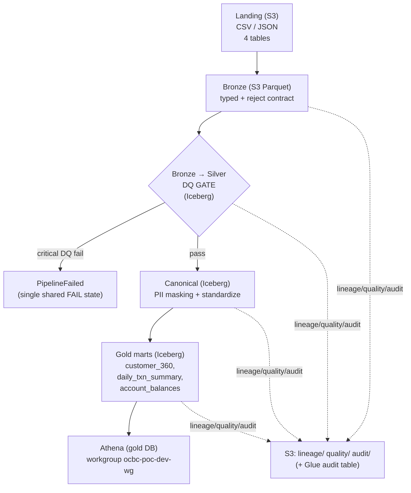

# OCBC POC — EMR Serverless medallion data pipeline

An end-to-end, POC-scale banking data ingestion pipeline on **AWS EMR
Serverless + PySpark**, provisioned with **Terraform**, orchestrated by **Step
Functions**, with a **medallion + canonical** architecture, an in-Spark **data
quality gate**, canonical-layer **PII masking**, lightweight **custom JSON
lineage** to S3/Glue, structured logging + a durable **audit table**, and
**Athena** on the gold database. It is built for a banking customer whose key
priorities are FinOps, data security, lineage, and tracking.

> New here? Start with [`INSTALL.md`](INSTALL.md) for step-by-step setup.

## Architecture at a glance

Data flows landing → bronze → silver → canonical → gold. The **DQ gate** lives
in the `bronze → silver` stage: a critical data-quality failure stops the run
(the Step Functions execution routes to a single shared FAIL state and never
advances to canonical). Every stage emits **lineage**, **quality**, and
**audit** records to their own S3 prefixes. Athena queries the gold database.



ASCII fallback (same flow):

```
                         +--------------------------------------------+
                         |  S3: lineage/  quality/  audit/            |
                         |  (+ Glue table ocbc_poc_dev_audit.*)       |
                         +--------------------------------------------+
                            ^        ^          ^            ^
                            | lin/q/aud (per stage, per table)
                            |        |          |            |
  +---------+   +--------+   +----------------+   +-----------+   +--------------+   +---------+
  | Landing |-->| Bronze |-->| Bronze->Silver |-->| Canonical |-->|  Gold marts  |-->| Athena  |
  | CSV/JSON|   |Parquet |   |  DQ GATE       |   | PII mask  |   | 3 Iceberg    |   | gold DB |
  | 4 tables|   |typed   |   | (Iceberg)      |   | (Iceberg) |   | tables       |   | wg      |
  +---------+   +--------+   +----------------+   +-----------+   +--------------+   +---------+
                                    |
                     critical DQ fail -> PipelineFailed (single shared FAIL state;
                                         execution STOPS, never advances to canonical)
```

Orchestration (Step Functions): `LandingToBronze → BronzeToSilver →
SilverToCanonical → CanonicalToGold → PipelineSucceeded`, with every stage's
`Catch [States.ALL]` routed to the one shared `PipelineFailed` state.

## Repository layout

| Path | What's there |
| --- | --- |
| `config/pipeline.yaml` | single source of truth: names, salt, row-count ranges, DQ rules |
| `data/generator/` | stdlib synthetic data generator + schema defs |
| `scripts/` | landing upload, local-checks orchestrator, optional Spark smoke |
| `src/common/` | config, io_paths, logging, masking, lineage, quality, audit, spark |
| `src/jobs/` | the four PySpark stage jobs |
| `infra/terraform/` | the full Terraform module + Step Functions ASL template |
| `sql/athena/` | setup notes + four example queries (gold marts + audit) |
| `docs/` | architecture, finops, security, lineage/quality/observability, PII catalog |
| `tests/` | pure-Python unit tests |
| `INSTALL.md` | step-by-step setup + deploy + teardown guide |

## Prerequisites

- **Python 3.11** target runtime (EMR). The local authoring host runs 3.14, but
  code stays 3.11-compatible (enforced by `black`/`ruff` `target-version =
  py311`). A green byte-compile on 3.14 is a smoke check, not a 3.11 guarantee.
- `PyYAML` + `boto3` for the generator/upload scripts; `pytest` for tests.
  `pyspark 3.5.*` is provided by the EMR runtime (not installed locally).
- For deploy only: Terraform >= 1.6, AWS credentials. See
  [`infra/terraform/README.md`](infra/terraform/README.md).

## Local verification (Windows, no AWS) — §13

Run the orchestrator, which prints a summary table:

```bash
python scripts/run_local_checks.py
```

It runs these steps (1–4 are mandatory; 5–6 skip-if-absent):

1. **Byte-compile** — `python -m compileall src data scripts` (+ `py_compile`
   each job entry point).
2. **Import-safe check** — import every `src/common` module (no Spark built).
3. **Run the generator** — `python -m data.generator.generate --out ./_local_out`
   and assert each table's row count is inside its configured
   `generator.row_counts` range and PII columns are populated.
4. **Unit tests** — `pytest tests/`.
5. **Terraform** — if on PATH: `init -backend=false`, `validate`, `fmt -check`;
   otherwise prints `SKIPPED: terraform not installed`.
6. **Local Spark smoke** — if `pyspark` + Java present, runs the full flow on
   tiny data and asserts the DQ gate fires under `--inject-dq-failure`;
   otherwise prints `SKIPPED`.

## What is verified locally vs. what requires AWS

**Verified locally** (on the bare Windows host, no AWS): Python byte-compile of
`src data scripts`; import-safety of every `src/common` module; a real run of
the synthetic data generator with row-count/PII assertions; and the pure-Python
unit tests (io_paths strings, masking determinism, lineage/quality/audit JSON
shapes, config validation). Terraform HCL and the Step Functions ASL template
are validated **by inspection** against design §8/§9 only.

**Requires AWS (deferred, NOT exercised here):** `terraform
init/validate/fmt/plan/apply` (terraform is absent from this host); the PySpark
transform runtime behaviour and the local Spark + Iceberg smoke (Java + pyspark
absent); the Athena ↔ Iceberg round-trip; EMR → CloudWatch log delivery; Step
Functions execution; and Iceberg overwrite/MERGE semantics. These are the
deploy-time verification surface documented in `infra/terraform/README.md`.

## Deploy to AWS

See [`infra/terraform/README.md`](infra/terraform/README.md) for the full
provision → sync code → upload data → run → query runbook. This baseline is the
starting point to iterate on; future scope (OpenLineage/Marquez, external Great
Expectations, Lake Formation masking, cost dashboards, CI/CD, DR) is explicitly
out of scope.
