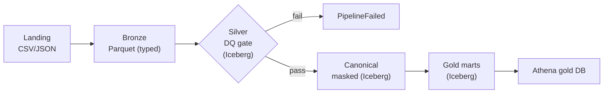

# Architecture

This POC implements a **medallion + canonical** lakehouse on AWS EMR Serverless,
orchestrated by Step Functions and queried through Athena. Everything is
deterministic from two inputs — `project = ocbc-poc` and `env = dev` — which
produce the `name_prefix = ocbc-poc-dev` used for every resource name.

## Flow narrative

```
Landing --> Bronze --> [Bronze->Silver DQ GATE] --> Canonical --> Gold --> Athena
   CSV/      Parquet      Iceberg (gate owner)       Iceberg      Iceberg   gold DB
   JSON                        |
                               +-- critical DQ fail --> PipelineFailed (STOP)
```



### 1. Landing (S3, raw)
Four banking tables land as files: `customers`, `accounts`, `cards` (CSV) and
`transactions` (JSON), under `s3://<datalake>/landing/<table>/`. Landing is raw
and **uncataloged** — the jobs write no managed table into the landing Glue DB
(it exists for AC4 + optional crawler use).

### 2. Landing → Bronze (`landing_to_bronze.py`, Parquet)
Reads each table with an explicit schema from `schema_defs`, casts strings to
target types, and adds audit columns (`_ingested_at`, `_run_id`,
`_source_file`). A **reject contract** applies: a non-empty source value that
casts to null is routed to `bronze/<table>/_rejected/` with a `_reject_reason`,
and `input_rows = output_rows + rejected_rows`. No DQ gate here — bronze lands
everything; silver is the gatekeeper. The Parquet table registers in Glue.

### 3. Bronze → Silver (`bronze_to_silver.py`, Iceberg) — the DQ gate owner
Cleanses (trim, normalize coded-column case), drops exact duplicates with a
full-row `distinct()`, then de-dupes on PK keeping the latest `_ingested_at`.
Tables are processed **parents before children**
(`customers → accounts → cards → transactions`) so referential checks read the
just-written silver parent. Per table it runs the fixed DQ sequence
(`run_expectations → emit_quality → enforce_gate`): quality JSON is always
written **before** the gate, and a critical failure raises, writes a
`DQ_FAILED` audit row, and exits non-zero. On pass it writes
`glue_catalog.ocbc_poc_dev_silver.<table>`.

### 4. Silver → Canonical (`silver_to_canonical.py`, Iceberg) — PII masking
Standardizes code/date/timestamp formats and applies **PII masking** (see
`pii_catalog.md`). Masking happens **only here** — silver keeps real keys so DQ
and lineage see true values; canonical is the first masked layer and gold
inherits masked values. Masked columns keep their original names/types in
canonical (the `*_masked` suffix appears only in the gold marts).

### 5. Canonical → Gold (`canonical_to_gold.py`, Iceberg marts)
Reads **canonical only** and builds three marts in `ocbc_poc_dev_gold`:

- **`customer_360`** — one row per `customer_id`, assembled from *separate*
  per-customer aggregations joined on `customer_id` (account metrics; card
  count via `accounts ⋈ cards`; txn metrics via `accounts ⋈ transactions`),
  **not** a flat join (which would fan out and corrupt counts).
- **`daily_txn_summary`** — grain `account_id × txn_date × currency`; money
  kept per currency (no FX).
- **`account_balances`** — one row per `account_id`, native currency, carrying
  the tokenized `customer_token`.

### 6. Athena (gold DB)
Athena v3 reads the Glue-registered Iceberg tables natively — no manual
`CREATE TABLE`. The `ocbc-poc-dev-wg` workgroup pins encrypted results. See
`sql/athena/`.

## Cross-cutting records

Every stage writes three per-table artifacts, keyed by `run_id`/`job`/`table`:

| Record | Location | Purpose |
| --- | --- | --- |
| Lineage | `s3://.../lineage/<run_id>/<job>/<table>.json` | inputs→outputs + column mappings |
| Quality | `s3://.../quality/<run_id>/<job>/<table>.json` | expectation results + pass/fail |
| Audit | Iceberg `ocbc_poc_dev_audit.pipeline_runs` + `s3://.../audit/<run_id>/<job>/<table>.json` | one durable row per table per job |

## Orchestration (Step Functions)

`ocbc-poc-dev-medallion-pipeline` runs the four stages sequentially via the
`emr-serverless:startJobRun.sync` integration. Each stage passes
`--run-id <execution-name> --env dev --all` (no `--job` — the job name is
derived from the script filename). Every stage's `Catch [States.ALL]` routes to
one shared `PipelineFailed` Fail state; the run ends at `PipelineSucceeded`. The
run id is generated at execution start and threaded into every job so lineage,
quality, and audit share a key. See `infra/terraform/medallion.asl.json.tftpl`.

## Naming summary

| Thing | Value |
| --- | --- |
| name_prefix | `ocbc-poc-dev` |
| Data-lake bucket | `ocbc-poc-dev-datalake-<account_id>` |
| Athena results bucket | `ocbc-poc-dev-athena-results-<account_id>` |
| Glue DBs | `ocbc_poc_dev_{landing,bronze,silver,canonical,gold,audit}` |
| EMR app | `ocbc-poc-dev-emr-serverless` |
| State machine | `ocbc-poc-dev-medallion-pipeline` |
| Athena workgroup | `ocbc-poc-dev-wg` |
| KMS alias | `alias/ocbc-poc-dev-datalake` |
